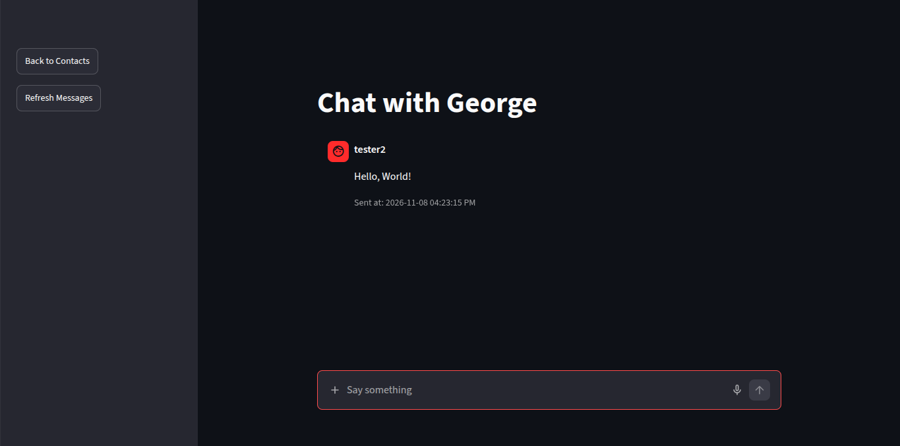
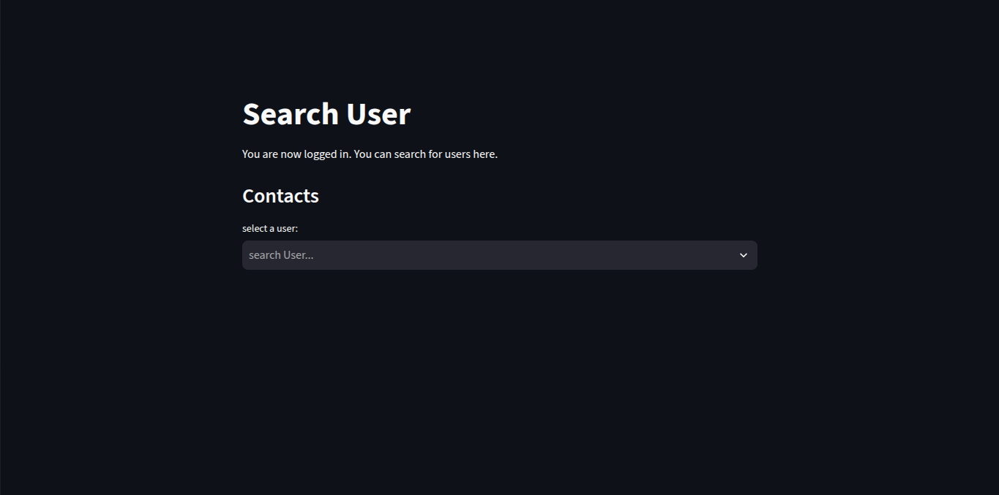
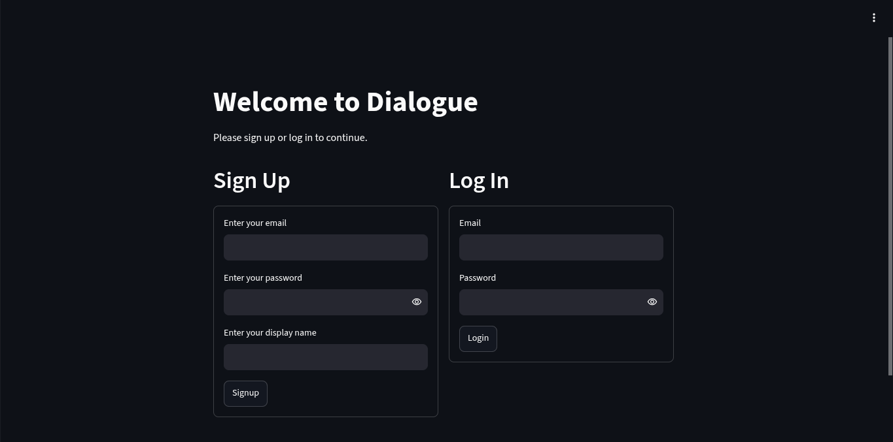

## Dialogue
This is an app I made for chatting with other people.
### Instructions
1. Go to [https://s125371.pyscriptapps.com/dialogue/latest/](https://s125371.pyscriptapps.com/dialogue/latest/)
2. Signup or login.
3. Select the user you want to chat with on the contacts screen.
**IT MAY TAKE A WHILE TO LOAD**
### How is this built?
This is built using Streamlit and Supabase
### Images
The Chatting Screen  
  
The Contacts Screen  
  
The Login/Signup Screen  

